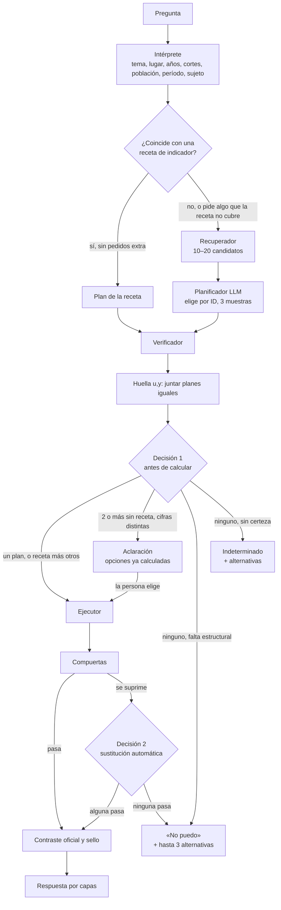

# Motor de inferencia a pedido sobre las encuestas del INEI

Documento de diseño · Pregúntale al Perú · 8 de noviembre de 2026 · Ubicación: `docs/diseno/motor_inferencia.md`

Este documento describe el motor que responde preguntas sobre la ENDES y la ENAHO calculando en el momento, a partir de las preguntas de los cuestionarios. Es la referencia del slice de implementación del motor y de los que siguen. `docs/especificaciones/motor.md` describe el motor actual y se actualiza en cada fase a medida que el nuevo lo reemplaza.

Cada sección tiene dos partes:
- **En sencillo:** qué es y por qué.
- **Detalle técnico:** cómo se construye.

## Índice

1. Objetivo y alcance
2. Principios
3. Vocabulario
4. Recorrido de una pregunta
5. Componentes y módulos
6. Almacén de microdatos
7. Índice de variables y tablas curadas
8. Recetas de indicador y conceptos armonizados
9. Intérprete en modo motor
10. Recuperador de candidatos
11. Planificador y plan de inferencia
12. Verificador, huellas y decisión antes de calcular
13. Aclaraciones
14. Ejecutor
15. Compuertas de calidad
16. Comparaciones
17. Sustitución automática y alternativas
18. Contraste oficial, sellos y confianza
19. Respuesta y contrato
20. Caché, registro y aprendizaje
21. Rendimiento, concurrencia y costo
22. Seguridad
23. Pruebas y evaluación
24. Migración desde el motor actual
25. Panel de la ENAHO
26. Gobierno
27. Fases e historias
28. Riesgos
29. Pendientes del dueño
30. Fuentes técnicas

Anexos:
- A. Esquemas de archivos
- B. Parámetros

---

## 1. Objetivo y alcance

**En sencillo.**
- Hoy la web responde con pocas cifras calculadas de antemano: anemia, desnutrición crónica y pobreza. El motor nuevo responde **lo que la persona pregunta**, siempre que las encuestas lo midan. Para eso busca qué pregunta del cuestionario lo responde, a quiénes se les hizo, en qué años y para qué territorios, y lo calcula en el momento teniendo en cuenta cómo se eligió la muestra.
- No guarda tablas con todas las combinaciones posibles. Guarda los datos de las encuestas, un índice bien hecho de sus preguntas y una memoria de lo que ya calculó.
- Las cifras que ya están validadas (el cubo actual y las cifras oficiales de control) son el **examen permanente** del motor: tiene que reproducirlas.

**Detalle técnico.**

| Dentro | Fuera |
|---|---|
| ENDES 2015–2025 y ENAHO 2015–2025, en corte transversal | Otras encuestas (se suman después con el mismo esquema) |
| Proporciones desde el inicio; medias, razones de totales y medianas descriptivas desde la fase 3 (§15.3) | Regresiones, efectos causales y estimación para áreas pequeñas |
| Nacional, departamento, ámbitos de Lima y región natural, según lo que permita cada año (E-02) | Provincias y distritos con encuestas: se sube al nivel que los contiene (R-ENC-06) |
| Cortes dentro de una encuesta: área, sexo, edad, quintil, educación, lengua, etc. | Totales con la ENDES calculados con sus pesos (los pesos no expanden: se usa la estimación derivada, §8.1) |
| «¿Cuántos?» con la ENDES como estimación derivada, para recetas verificadas (desde la fase 2, §8.1) | — |
| Cambios entre años y diferencias entre grupos, con prueba | — |
| ENAHO Panel (transiciones de pobreza): fase 5 | — |

- Los registros administrativos (gasto del MEF y SIEN del INS) siguen por el camino actual: no son muestras.
- El cruce gasto × anemia (CR-01) se mantiene; el lado de la encuesta lo calcula el motor nuevo.

**Cómo leer este documento.**
- **El dueño:** las partes «En sencillo» de los §1–4, 13, 17–19 y 26–29.
- **El agente implementador:** los §4–5 (recorrido y módulos), después cada componente en orden (§6–22), las pruebas (§23), las historias de su fase (§27) y los anexos A y B.

---

## 2. Principios

**En sencillo.** Seis reglas, en orden de prioridad.

1. **Tres salidas, según los insumos.** Los **insumos** son lo que hace falta para responder: la encuesta y su pregunta, el año, el lugar y que la muestra alcance para ese lugar.
   - **Responde** cuando entiende la pregunta y tiene los insumos.
   - **Pregunta** cuando tiene dudas. Solo pregunta lo que decide qué dato usar, y cada opción que ofrece es algo que sí puede responder.
   - **Dice «no puedo»** solo cuando está seguro de que falta un insumo. Explica cuál y ofrece hasta 3 alternativas cercanas que sí puede responder.

   Cuando no logra saber si tiene o no el insumo, no dice «no puedo»: ofrece lo que sí tiene y anota el caso para revisarlo (estado `indeterminado`).
2. **El modelo de lenguaje elige; el código calcula.** El modelo de lenguaje (LLM) entiende la pregunta y elige entre opciones que existen en el índice. No escribe código ni produce números.
3. **Cómo se pesa la muestra no se elige: se deriva.** El peso, el estrato, el conglomerado y a quién se cuenta salen de tablas que una persona escribe leyendo las fichas técnicas del INEI, nunca del LLM.
4. **Primero lo oficial.** Si la pregunta coincide con un indicador oficial (anemia, desnutrición, pobreza…), se usa su definición oficial, comprobada contra la cifra del INEI.
5. **Todo se puede revisar.** Cada respuesta dice qué pregunta de la encuesta se usó, a quiénes se contó, de dónde viene la cifra y con qué precisión.
6. **Calidad antes que cobertura.** Es preferible responder bien menos preguntas que responder más con dudas.

**Detalle técnico.** La experiencia publicada respalda este orden (§30):
- donde el LLM solo elige un indicador y no toca los datos, las cifras citadas son correctas el 98,6–98,9 % de las veces;
- donde agentes analizan encuestas libremente a partir de su documentación, aciertan alrededor del 69 %;
- en catálogos con cientos de columnas, el error dominante es elegir la columna equivocada.

---

## 3. Vocabulario

| Término | Significado |
|---|---|
| **ENDES, ENAHO** | Encuesta Demográfica y de Salud Familiar; Encuesta Nacional de Hogares (INEI) |
| **Archivo** | Una tabla de un ZIP del INEI para un año (por ejemplo RECH0, RECH6, REC0111, REC43 de la ENDES; enaho01-2024-200 de la ENAHO). Es la unidad del almacén y del índice |
| **Unidad de análisis** | A quién se cuenta: hogar, persona, mujer de 15–49 años, niño o niña |
| **Universo del cuestionario** | A quién se le hizo la pregunta, según los saltos del cuestionario |
| **Universo analítico** | A quién cuenta el INEI al publicar, por convención (por ejemplo, niños de la población de hecho con hemoglobina medida) |
| **`u` e `y`** | Por cada fila: `u` = 1 si la fila está en el universo (denominador); `y` = 1 si cuenta como «sí» (numerador) |
| **Dominio** | Grupo para el que se calcula una cifra: un territorio, un corte o su combinación |
| **Corte** | División de la población por una característica (área, sexo, quintil…) dentro de la misma encuesta |
| **Cruce** | Dos cifras de **fuentes distintas** vistas juntas (por ejemplo gasto × anemia). Se rige por la lista blanca R-03 |
| **Diseño muestral** | Cómo se eligió la muestra: estratos, conglomerados (UPM: unidad primaria de muestreo) y pesos. Sin él, el margen de error sale mal |
| **ee, CV, gl, n, n efectivo** | Error estándar; coeficiente de variación; grados de libertad; casos sin ponderar; casos equivalentes después del efecto del diseño |
| **Concepto** | Una misma cosa medida, con su variable en cada año (por ejemplo, «recibió suplemento de hierro en los últimos 7 días») |
| **Receta de indicador** | La definición oficial de un indicador (numerador, denominador, universo, transformaciones), con su cifra oficial de control. Distinta de la **receta de fuente** (`curados/recetas/`), que dice cómo se descarga una fuente |
| **Cifra dorada** | Una cifra publicada por el INEI o el INS que el motor debe reproducir (`cifras_doradas`) |
| **Cubo** | La tabla de cifras precalculadas del motor actual (`fact_indicador`, huella `010ea965…`) |
| **Plan** | La ficha cerrada que dice qué calcular: encuesta, años, unidad, indicador, universo, cortes y territorio |
| **`huella_datos`** | Identidad de los datos de un archivo: sha256 del ZIP oficial + versión del conversor |
| **`huella_uy`** | Firma de un plan sobre los datos: sha256 de las tuplas (`llave_fila`, `u`, `y`, `corte`) ordenadas, por año. Dos planes con la misma `huella_uy` dan la misma cifra |
| **`llave_fila`** | Identificador de la unidad de análisis declarado en el índice (por ejemplo, CASEID + índice del niño), más el año |
| **`id_plan`** | sha256 del plan normalizado; identifica una opción de aclaración y es la llave de la caché |
| **Compuertas** | Reglas que deciden si una cifra se publica, se publica como referencial («aproximada») o se suprime: R-ENC-02 a R-ENC-04 |
| **Falta estructural** | Un insumo que falta y se puede comprobar (§12.4) |
| **Estados del índice** | `propuesto` (automático) → `revisado` (auditor-agente y visto del dueño por lote) → `verificado` (**solo** recetas de indicador que reproducen su cifra oficial) |
| **Capas** | La respuesta: capa 1 visible (≤ 125 palabras); capa 2 «Más contexto»; capa 3 «Para citar y verificar» |
| **Slice, historia** | Bloque de trabajo del agente implementador y cada tarea dentro de él (`backlog/`) |
| **Tipo C** | Asunto que el agente no resuelve solo: cifras, reglas, decisiones, fuentes o privacidad (`agents.md` §5) |

---

## 4. Recorrido de una pregunta

**En sencillo.** La pregunta pasa por una cadena de estaciones y termina siempre en una de estas salidas: **respuesta**, **pregunta de aclaración**, **«no puedo»** o **`indeterminado`**. Hay dos momentos en que se decide:
1. **Antes de calcular:** ¿hay una forma clara de responder, varias que dan cifras distintas o ninguna?
2. **Después de calcular:** ¿la cifra tiene casos suficientes? Si no, ¿hay una cercana del mismo año que sí los tenga?



**Detalle técnico. Tres recorridos de ejemplo.**

1. **«¿Cuánta anemia hay en Cusco?»**
   - El intérprete reconoce el tema anemia y el lugar Cusco (departamento, T-03), y toma el último año.
   - Coincide con la receta `endes_anemia_6_35m_oms2024` sin pedidos extra, así que no se llama al planificador.
   - El verificador acepta, el ejecutor calcula y las compuertas lo dejan pasar.
   - La cifra coincide con la del INEI y sale con el sello «Cifra oficial del INEI».
2. **«¿Los niños del campo en Puno reciben hierro?»**
   - No hay receta. El recuperador trae candidatos: «recibió suplemento de hierro (gotas o jarabe) en los últimos 7 días» (niño), «recibió micronutrientes en polvo» (niño), «tomó hierro durante el embarazo» (mujer).
   - El verificador descarta el del embarazo porque su sujeto no coincide.
   - Quedan dos planes con `huella_uy` distinta y cifras que difieren en 2 puntos o más.
   - Ambos se calculan y pasan las compuertas, así que la salida es una aclaración: «¿Te refieres al suplemento de hierro en gotas o jarabe, o a los micronutrientes en polvo (chispitas)?». Cada opción lleva su `id_plan`.
   - El corte «del campo» es el corte estándar `area = rural`.
3. **«¿Cuánta anemia hay en el distrito de Ate?»**
   - Coincide con la receta de anemia, pero la ENDES no permite inferir por distrito.
   - Por R-ENC-06 se sube automáticamente a Lima Metropolitana, el ámbito que lo contiene. La respuesta lleva el bloque `sustitucion`: «Pediste: distrito de Ate. Te mostramos: Lima Metropolitana; la encuesta no alcanza para distritos».
   - Entre las alternativas aparece el registro de los establecimientos de salud del distrito (SIEN), que es otra fuente.

---

## 5. Componentes y módulos

**En sencillo.** El motor nuevo vive en un paquete propio del código, separado del actual, para que ambos convivan mientras se hace el cambio.

**Detalle técnico.** Paquete nuevo `src/pap/inferencia/`. Los nombres de los módulos no chocan con los de `src/pap/motor/`, que se mantiene.

| Estación | Módulo | Entrada | Salida |
|---|---|---|---|
| Índice | `inferencia/indice.py` (CLI `pap variables indexar`) | ZIP registrados | `biblioteca/variables/{archivos,variables,categorias}.parquet` |
| Conversor | `inferencia/almacen.py` (CLI `pap microdatos convertir`) | ZIP registrados | `biblioteca/microdatos/…parquet` + manifiesto |
| Tablas curadas | `inferencia/tablas.py` | `curados/inferencia/*.csv`, `*.yaml` | objetos validados |
| Intérprete (modo motor) | `src/pap/interprete/` (se amplía) | texto | `Interpretacion` (§9) |
| Coincidencia con receta | `inferencia/recetas.py` | `Interpretacion` | `Plan` de receta o nada |
| Recuperador | `inferencia/recuperador.py` | `Interpretacion` | lista de `Candidato` (§10) |
| Planificador | `inferencia/planificador_llm.py` | `Interpretacion` + candidatos | hasta 3 `Plan` (§11) |
| Gramática | `inferencia/gramatica.py` | `Plan` | SQL con parámetros |
| Verificador | `inferencia/verificador.py` | `Plan` | `Plan` completo (diseño y universo agregados) o `Falla(tipo, dimension, motivo)` |
| Huellas | `inferencia/huellas.py` | `Plan` | `huella_uy`, `id_plan`, cifra puntual |
| Decisión | `inferencia/decision.py` | planes, fallas | `Salida` (§12.3) |
| Ejecutor | `inferencia/ejecutor.py` (pool de procesos) | `Plan` | `Estimacion` por dominio (§14) |
| Compuertas | `inferencia/compuertas.py` | `Estimacion` | estado: publicar, referencial o suprimir, con su motivo |
| Comparaciones | `inferencia/comparaciones.py` | estimaciones | pruebas (§16) |
| Sustitución y alternativas | `inferencia/alternativas.py` | plan, motivo | planes alternativos calculados |
| Contraste y sello | `inferencia/contraste.py` | estimación, doradas | sello y contraste (§18) |
| Respuesta | `inferencia/respuesta.py` (reutiliza `src/pap/motor/capas.py` y el validador) | todo lo anterior | `respuesta.json` v2 (§19) |
| Caché | `inferencia/cache.py` | `id_plan` | estimación cruda |

Ubicación de los datos y archivos nuevos:
- **Archivos curados nuevos:** `curados/inferencia/`.
- **Datos nuevos:** `biblioteca/microdatos/` y `biblioteca/variables/`.
- La carpeta `catalogo/` existente es el catálogo de **fuentes** y no cambia de propósito.

---

## 6. Almacén de microdatos

**En sencillo.** Cada archivo de cada año se guarda una sola vez, comprimido, en un formato rápido de leer. Al responder se leen solo las columnas que hacen falta. Los ZIP originales del INEI se guardan tal como se bajaron, para poder reconstruir todo.

**Detalle técnico.**
- **Ruta:** `biblioteca/microdatos/{encuesta}/{anio}/{archivo}.parquet` (zstd), con un `manifiesto.json` por año. El manifiesto lleva:
  - la `huella_datos`;
  - filas y columnas;
  - las versiones de `pyreadstat`, `pyarrow`, `polars`, `duckdb` y `svy`.

  La huella del Parquet solo sirve como control de integridad (cambia con la versión del escritor).
- **Conversión:**
  - formato por año según la consulta K-06 (recomendación: Stata donde el INEI lo publica, que es el formato del cubo y de los ZIP ya registrados de 2024, y SPSS en la ENDES 2015–2020, que solo existe en ese formato). El conversor normaliza los perdidos de los dos formatos a la misma representación: nulo en la columna y código en el índice;
  - lectura con `pyreadstat` y `user_missing=True` para conservar los códigos especiales;
  - las etiquetas van al índice, no al Parquet.
- **Tipos por clase de columna** (la declara el índice):
  - `llave` y `geo`: texto de ancho fijo, normalizado y sin espacios. Por ejemplo HHID (9), CONGLOME (6), VIVIENDA (3), UBIGEO (6), departamento (2);
  - `categoria`: entero;
  - `medida`: numérico.
- **Obtención:**
  - los ZIP los baja el dueño a mano, o el agente en el Mac si su entorno llega a `.gob.pe`, y se dejan en `biblioteca/cruda/bandeja/INEI-ENDES/` (o `INEI-ENAHO/`);
  - se registran uno por uno con `pap registrar <fuente> <zip> --recurso <encuesta>-<anio>-<nombre> --url-descarga <url> --mover`;
  - la lista de ZIP de cada fase la arma el agente desde las recetas de fuente (`curados/recetas/INEI-ENDES.yaml`, `INEI-ENAHO.yaml`) y la aprueba el dueño;
  - los códigos de módulo y las URL salen de `curados/recetas/inei_microdatos_catalogo.json`, que ya está en el repo y se tomó del portal del INEI. Solo si falta un código se consulta el catálogo del repositorio `inei-microdatos`, fijando su commit y huella;
  - las huellas de los ZIP quedan en `capturas/<fuente>/*/datapackage.json` al registrar, y en `curados/insumos.lock.yaml` cuando `pap microdatos convertir` las usa.
- **Tamaño** (estimado; se mide en cada fase y fija el tope de F-04):

  | Bloque | ZIP | Parquet | Se mide en |
  |---|---|---|---|
  | ENDES 2024 (13 módulos) | 80–150 MB | 50–100 MB | fase 0 |
  | ENDES 2015–2025 | 1–2 GB | 0,5–1 GB | fase 0 (proyección) y fase 2 |
  | ENAHO 2015–2025 (unos 30 módulos por año) | 4–8 GB | 4–6 GB | fase 3 |
  | Panel ENAHO (solo los módulos usados) | 1–2 GB | 1–2 GB | fase 5 |

  La base de la estimación son los ZIP ya registrados: hogar de la ENDES, 4–8 MB por año; anemia, 7–10 MB; sumaria de la ENAHO, 15 MB. El 9/11/2026 el Mac tenía 109 GB libres.
- **Licencia y publicación:** el repo principal es **público**.
  - Los ZIP crudos **nunca** van al repo público.
  - Los Parquet de la ENDES pueden publicarse en un release del repo principal, con atribución al INEI y la licencia ODbL 1.0, como la registra el catálogo de fuentes.
  - Los Parquet de la ENAHO solo se publican si se confirma que su licencia lo permite (consulta antes de la fase 3). Si no lo permite, van al repo privado de crudos.
- **Respaldo de los crudos (decisión del dueño, 9/11/2026):** repo **privado** `LaurenteEber/preguntale-al-peru-crudos` (creado por el dueño el 9/11/2026).
  - Un release por encuesta y año (etiqueta `crudos-{encuesta}-{anio}`), con un `SHA256SUMS` y un `LEEME.txt` con la atribución y la licencia.
  - Cada archivo pesa menos de 2 GiB; si alguno lo supera, se parte con `split`.
  - Lo sube `scripts/respaldar_crudos.sh`, que **se niega a subir** si el repo de destino no es `LaurenteEber/preguntale-al-peru-crudos` o si no es privado (`gh repo view --json visibility`).
  - Token de `gh` de grano fino, solo para ese repo y con `contents: write`.
- **Ciclo por bloque** (un bloque = una encuesta y un año):
  1. registrar los ZIP;
  2. convertir a Parquet e indexar;
  3. respaldar en el repo privado;
  4. probar la restauración: `pap almacen restaurar` baja el release a un directorio temporal, comprueba las huellas contra `datapackage.json` y reconvierte un archivo hasta obtener una `huella_contenido_v1` idéntica;
  5. marcar el bloque como `respaldado` en `biblioteca/cruda/almacen_zst.json`, con la fecha y la URL del release;
  6. **liberar** los ZIP locales del bloque con `pap almacen liberar`, solo si se cumplen las condiciones de abajo.
- **Liberación del espacio local:**
  - **Qué se libera:** solo los ZIP de bloques `respaldado` con la restauración probada.
  - **Qué no se libera nunca:**
    - los Parquet y su manifiesto;
    - `datapackage.json`, que conserva la huella, el tamaño y la URL del release;
    - `insumos.lock.yaml` e `indice.duckdb`;
    - los crudos de otras fuentes (MEF, SIEN, proyecciones);
    - los ZIP que lee el motor actual (`pap calcular`: hogar y anemia de la ENDES, sumaria de la ENAHO).
  - **Cómo:** `pap almacen liberar --bloque <encuesta>-<anio>` muestra la lista y el espacio que liberaría, y pide confirmación. `--simular` es el modo por defecto.
  - **Cuándo:** al cerrar cada fase, o antes si el espacio libre baja de `almacen.espacio_libre_min_gb`.
  - **Consecuencia:** reconvertir un bloque liberado obliga a bajarlo antes con `pap almacen restaurar`. Las respuestas no cambian, porque el motor lee los Parquet.
  - **Toda liberación** queda en `biblioteca/cruda/verificaciones.jsonl`.

---

## 7. Índice de variables y tablas curadas

**En sencillo.**
- El índice es el mapa de las encuestas: para cada pregunta de cada año dice qué mide, a quién se le hizo, qué respuestas admite, en qué archivo está y cómo se une con los demás.
- Junto al índice hay tablas que escribe una persona leyendo las fichas técnicas: cómo se pesa cada archivo, qué cambió cada año y qué años comparten conglomerados. Esas tablas no las escribe el LLM, porque un error ahí no lo detecta ninguna prueba.

### 7.1 Índice propio

**Detalle técnico.**
- `pap variables indexar` recorre **todos** los archivos de cada ZIP registrado con `pyreadstat` (`metadataonly=True` y `user_missing=True`, porque sin esta opción no se ven los rangos de perdidos), sin tope en el número de etiquetas. Los códigos especiales se proponen también por la etiqueta, como «no sabe», «no responde» o 98 y 99 con etiqueta, porque el INEI a veces los deja como valores normales.
- Escribe `archivos.parquet`, `variables.parquet` y `categorias.parquet` en `biblioteca/variables/` (esquemas en el anexo A).
- **Prueba de completitud:**
  - cada archivo de cada ZIP está indexado;
  - las variables del índice son exactamente las columnas del Parquet;
  - las variables de las recetas de indicador (HC1, HC55, HC57, HC57A, HC70, HV005, HV005A, HV103, FACTOR07, MIEPERHO, POBREZA, entre otras) aparecen en todos sus años.

### 7.2 Campos de cada variable

| Campo | Contenido | Quién lo llena |
|---|---|---|
| `var_id` | `encuesta·año·archivo·código` | índice |
| `clase` | `llave`, `geo`, `categoria`, `medida`, `peso`, `diseno` | índice + revisión |
| `tipo_valor`, `rango_valido` | categórica, numérica o texto; rango válido de las numéricas | índice + revisión |
| `codigos_especiales` | banderas y códigos como 98, 99 o 9996–9999, con su significado | índice + revisión |
| `rol_faltante` | por código: `faltante_excluye` (sale del denominador) o `faltante_cuenta_no` (queda en el denominador, fuera del numerador) | revisión, por concepto |
| `etiqueta_original`, `etiqueta_curada` | la del archivo y la corregida (erratas, mojibake, vacías) | índice + controles + revisión |
| `texto_pregunta` | texto del cuestionario | cuestionario (PDF) + revisión |
| `universo_cuestionario` | salto: a quién se le hace la pregunta (predicados, §11.3) | cuestionario + LLM fuera de línea + revisión |
| `ventana_referencia` | «últimos 7 días», «últimos 6 meses», «alguna vez» | LLM fuera de línea + revisión |
| `sujeto` | sobre quién trata: niño, madre, embarazo, hogar | LLM fuera de línea + revisión |
| `informante`, `modo` | quién responde y cómo se obtuvo: declarado o medido | LLM fuera de línea + revisión |
| `grupo` | batería o respuesta múltiple a la que pertenece | índice (prefijo) + revisión |
| `tipo_origen` | `pregunta`, `construida_inei` (sumaria, pobreza, deflactores) o `recodificada` | revisión |
| `universo_corto` | ≤ 12 palabras para la capa 1 | LLM fuera de línea + revisión |
| `concepto_id` | concepto armonizado (§8.2) | propuesto por similitud, aprobado en revisión |
| `estado` | `propuesto` o `revisado` | flujo de curaduría (§26.4) |

Reglas:
- Las variables `construida_inei` solo se usan en recetas de indicador.
- Las variables `propuesto` no se usan en respuestas públicas.

### 7.3 Controles automáticos

Cada control, si salta, marca la variable para revisión:
- la misma variable tiene otra etiqueta en otro año;
- hay mojibake (se repara con `ftfy`; el de DOS, cp850, se relee con esa codificación);
- la etiqueta está vacía;
- el `universo_cuestionario` coincide con el patrón real de valores no vacíos en menos del 99,5 % de las filas;
- la frecuencia de un código especial cambia mucho entre años.

### 7.4 Tablas curadas

Viven en `curados/inferencia/`, cada una con su cita a la ficha técnica. Los esquemas completos están en el anexo A.

- **`diseno_muestral.csv`** (unas 150 filas, una por encuesta × año × archivo × medición):
  - expresión del peso (por ejemplo `HV005/1e6`, `HV005A/1e6` en las mediciones de 2020, `V005/1e6`, `PESO15_AMAS/1e6`, `FACTOR07*MIEPERHO`, `FAC500A`);
  - estrato: `HV024||'-'||HV022` (E-01), o `DEPARTAMENTO||'-'||ESTRATO` en la ENAHO;
  - UPM (en la ENDES, HV021, como hoy en `definiciones_endes.yaml`) y UPM estable entre años (la que declare la ficha técnica);
  - `peso_normalizado` (sí en toda la ENDES);
  - uniones necesarias para el diseño;
  - nivel de la submuestra.
- **`universos_analiticos.yaml`:** las convenciones del INEI por unidad y medición, por ejemplo:
  - `nino_hecho_hb_medida`;
  - `nino_hijo_de_entrevistada`;
  - `mujer_15_49_entrevistada`.

  Salen de `curados/capa0/definiciones_endes.yaml`, de las definiciones del INEI y del código de indicadores de la DHS (DHS-Indicators-R).
- **`perfil_anual.csv`** (encuesta × año):
  - marco y muestra maestra;
  - estratos, UPM, modo de entrevista y meses de campo;
  - `ubigeo_minimo` (en la ENDES 2015–2017 no hay ubigeo de distrito);
  - pesos especiales;
  - `clase_cambio` frente al año anterior (`corte` o `aviso`), que decide el dueño según E-07.
- **`relacion_entre_anios.csv`** (encuesta × par de años):
  - `relacion` ∈ {`independiente`, `conglomerados_repetidos`, `panel_parcial`} y la llave de la UPM estable;
  - por ejemplo, la ENDES mantiene el 66,7 % de los conglomerados de un año a otro desde 2022, y la ENAHO visita cada año los mismos conglomerados y tiene una submuestra panel de viviendas;
  - si la ficha no lo declara, la relación es `independiente` y la prueba lleva el aviso «conservadora».
- **`territorios.yaml`:** cómo se arma cada nivel territorial por encuesta y año, igual que hoy (`src/pap/capa0/ambitos_lima.py`, `calculo.py`). Por ejemplo, en la ENDES:
  - `nacional`;
  - `dominio_subnacional` (área urbana o rural);
  - `departamento` (HV024, sin el 07);
  - `CALLAO` (HV024 = 07);
  - `LIMA_METROPOLITANA` (ubigeo de la provincia 1501);
  - `LIMA_REGION` (HV024 = 15, fuera de 1501).

  Cada uno con su cita. Los ámbitos se estiman como dominio.
- **`cortes_estandar.yaml`:** los cortes que se ofrecen (área, sexo, grupo de edad, quintil, región natural, educación de la madre, lengua materna), con su variable por encuesta, año y unidad, y sus categorías en palabras. Los cortes no los elige el LLM: el intérprete los reconoce y el código los traduce.
- **`no_cubre.yaml`:** temas que se sabe que la ENDES y la ENAHO no miden. Es lo único que permite afirmar un «no puedo» por tema (§12.4).
- **`sinonimos.yaml`:** vocabulario peruano y de programas para la búsqueda (chispitas → micronutrientes, posta → establecimiento de salud, SIS, Qali Warma, sulfato ferroso…).

---

## 8. Recetas de indicador y conceptos armonizados

### 8.1 Recetas de indicador

**En sencillo.** Muchas cifras oficiales no salen de una sola pregunta sino de una fórmula: la anemia se ajusta por la altitud y la pobreza compara el gasto con una línea. Esas fórmulas se escriben una vez, se comprueban contra la cifra del INEI y el motor las usa primero. **Solo las recetas que reproducen su cifra oficial llevan la marca `verificado`.** Una receta que todavía no la reproduce no se usa en público.

**Detalle técnico.**
- **`dim_indicador`** (`curados/capa0/dim_indicador.yaml`) sigue siendo el **único** catálogo de indicadores:
  - los indicadores de encuesta ganan el campo `receta`, que apunta a `curados/inferencia/recetas/<id>.yaml`;
  - los del SIEN, el gasto y el Mapa de Pobreza siguen por el camino actual.
- **Una receta lleva** (esquema en el anexo A):
  - unidad;
  - universo analítico;
  - predicados del indicador (§11.3);
  - transformaciones, solo si el INEI no entrega la variable ya construida. Por ejemplo, la anemia usa HC57 (criterio anterior) y HC57A (OMS 2024), que el INEI ya entrega ajustadas por altitud, y la desnutrición crónica usa HC70 con sus banderas. Las recetas de la fase 0 no tienen transformaciones;
  - medida;
  - cortes permitidos;
  - doradas asociadas;
  - `estado` (`revisado` o `verificado`).
- **Recetas de la fase 0:** `endes_anemia_6_35m`, `endes_anemia_6_35m_oms2024` y `endes_dci_menores_5`. En la fase 3 se suma `enaho_pobreza_monetaria`.
- **Prueba:** el resultado de cada receta debe igualar al cubo `010ea965`:
  - valor, ee, IC, CV y deff redondeados a 8 decimales, como hace el cubo (`DECIMALES` en `calculo.py`), con |dif| ≤ 1e-8;
  - casos y gl idénticos;
  - el n efectivo se compara contra mín(n, n efectivo del cubo), porque el cubo no lo topa.

  Además, sin redondear, contra el cálculo actual (`calculo._svy_niveles`) con |dif| ≤ 1e-12. La tolerancia de ±0,1 pp de E-05 es para comparar con las cifras **oficiales** del INEI, no con el cubo.
- Las variables `construida_inei` (pobreza, ingreso, deflactores) solo se usan aquí.
- La mortalidad solo se responde por receta (E-09).
- **«¿Cuántos?» con la ENDES (X-24, decisión del dueño).** Los pesos de la ENDES no expanden a la población, así que el número se calcula con una **receta derivada**: proporción de la ENDES × población proyectada del INEI (T-04, T-05) para el mismo grupo de edad, lugar y año.
  - **Alcance:** solo para recetas `verificado` (anemia, desnutrición crónica), desde la fase 2, y solo donde la ENDES permite inferir (nacional, departamento y ámbitos de Lima).
  - **Presentación:** se redondea a miles (R-ENC-17) y el texto siempre separa las dos fuentes. Por ejemplo: «La ENDES estima que 30 % de las niñas y los niños de 6 a 35 meses de Cusco tiene anemia. Con la población proyectada por el INEI para ese grupo (unos 60 000), eso equivale a aproximadamente 18 000 niños».
  - **Intervalo:** proporción (límite inferior y superior) × población, con la nota «el margen solo refleja la incertidumbre de la encuesta, no la de la proyección».
  - **Sello:** «Porcentaje: ENDES (INEI). Total: cálculo propio con la población proyectada del INEI».
  - **Correspondencia de edades:** si la proyección no tiene el mismo rango de edad, se usa la convención de T-05 (denominadores por edad) y se declara.
- Los totales de población salen de la proyección del INEI (T-04).

### 8.2 Conceptos armonizados

**En sencillo.** Una pregunta puede cambiar de código o de redacción entre años. Un concepto une esas variables para poder comparar años sin mezclar cosas distintas. Que el nombre de la variable se repita no basta para darlas por equivalentes.

**Detalle técnico.**
- **Un concepto lleva:**
  - `id`, nombre, `concepto_padre` y `fuente_preferida` (si lo miden la ENDES y la ENAHO);
  - un mapa año → (archivo, variable, categorías del «sí», restricciones del universo, `rol_faltante`).
- **Banderas:** `pregunta_cambio`, `categorias_fusionadas`, `universo_cambio` y `quiebre_serie`.
- **Reporte automático** por cada par de años antes de aprobar:
  - la diferencia de texto de la pregunta y de las etiquetas;
  - el cambio en el n del universo;
  - un salto de la media ponderada mayor que 3 ee frente a la tendencia.
- **Aprobación:** el concepto se aprueba con el reporte en verde y, si existe, reproduciendo la serie del INEI. Mientras haya banderas abiertas, la serie se corta (E-07).
- **Varios años:** un plan de varios años **solo** es posible sobre un concepto aprobado o una receta. Sin concepto, el plan es de un solo año.
- **Prioridad:** se armonizan primero los conceptos con cifra oficial o con demanda.

---

## 9. Intérprete en modo motor

**En sencillo.** Es la estación que lee la pregunta. En el motor nuevo ya no decide si un tema «existe»: anota lo que la persona pidió, con sus palabras. Si el dato existe o no, lo dice el índice.

**Detalle técnico.**
- **Base:** se amplía el intérprete actual (Sonnet 5.5, anclas literales, caché de 24 h, limpieza de DNI, RUC, celulares y correos según P-03), con un **modo motor** que se activa por parámetro. La salida estructurada del proveedor sigue apagada (`salida_estructurada: false`) y el código valida el JSON.
- **Cambios del modo motor:**
  - `tema_texto` literal y anclado. El tema curado de hoy queda como pista para la coincidencia con receta.
  - Se elimina `fuera_de_alcance` por tema: un tema nuevo pasa al recuperador.
  - Se conservan `fuera_de_alcance: pregunta` (predicciones, opiniones) y el rechazo de lo que no es una pregunta, con el tipo de respuesta `mensaje`.
  - Ranuras nuevas, ancladas al texto o vacías: `poblacion`, `periodo_referencia`, `sujeto`, `medida` (proporción, cuántos, promedio) y `cortes[]` (texto que se traduce a `cortes_estandar.yaml`).
  - **Nuevo:** si la pregunta no está en español, se responde con un `mensaje` que ofrece seguir en español. La detección del quechua es parte de esta historia.
- **Valores por defecto, sin preguntar:**
  - el año es el último con datos;
  - un nombre de departamento se responde como departamento (T-03);
  - ambos se dicen en «Entendimos».
- **Aclaraciones de lugar:** «Lima» a secas se pregunta (T-03). Los homónimos de lugar los aclara el resolutor territorial del motor. Ambos cuentan en el tope común de aclaraciones (§13).
- **Coincidencia con receta.** Ocurre si:
  - el tema curado tiene receta;
  - la medida pedida es la de la receta;
  - las ranuras `poblacion`, `periodo_referencia` y `sujeto` están vacías o son compatibles con la receta;
  - los cortes pedidos están entre los permitidos por la receta.

  Si coincide y no hay nada más pedido, **no se llama al planificador**. Si la pregunta pide algo que la receta no cubre, se llama al planificador **y** la receta entra como un plan más.

---

## 10. Recuperador de candidatos

**En sencillo.** Busca en el índice las preguntas de encuesta que podrían responder lo que se pidió, por las palabras y por el significado, y entrega una lista corta para que el planificador elija.

**Detalle técnico.**
- **Sin filtro previo** de año, lugar ni nivel. Esas dimensiones las aplica el verificador. Si se filtraran antes, una variable vecina que sí existe ese año ocuparía el lugar de la correcta.
- **Búsqueda por palabras:** BM25 con `bm25s` y el stemmer de español (`PyStemmer`), sobre la etiqueta curada, el texto de la pregunta, las etiquetas de las categorías, el universo corto y los sinónimos expandidos. La razón está en `docs/diseno/tecnologias.md`.
- **Búsqueda por significado:** `intfloat/multilingual-e5-small` en ONNX, con `onnxruntime` y `tokenizers`. Lleva los prefijos `query:` y `passage:`, y se calcula un vector por texto distinto.
  - Los vectores del índice se calculan fuera de línea y se guardan con la huella del modelo; en línea solo se codifica la pregunta.
  - Si el recall no alcanza, se prueba un modelo mayor o un reordenador local.
- **Fusión:**
  - se combinan las dos búsquedas con RRF;
  - las baterías se agrupan por `grupo`;
  - solo entran variables `revisado` de clase `categoria` o `medida`;
  - salen de 10 a 20 candidatos con un ID corto (`c01`…`c20`).
- **Filtros de significado:**
  - si la pregunta trae `sujeto` o `periodo_referencia` y el candidato tiene otro valor, se descarta;
  - si la pregunta no los trae, el candidato queda, y su valor se dice en la capa 1.
- **Métrica:** recall@20 contra el conjunto de evaluación, también por subconjunto (pares casi iguales y vocabulario popular).

---

## 11. Planificador y plan de inferencia

**En sencillo.** El LLM recibe la pregunta interpretada y la lista corta de candidatos, y llena una ficha cerrada:
- qué candidato mide lo pedido;
- qué respuestas cuentan como «sí»;
- a quiénes se cuenta.

No escribe código, no inventa variables y no elige el peso ni los cortes. Si elige algo que no está en la lista, el código lo rechaza.

### 11.1 Llamada al LLM

**Detalle técnico.**
- **Una llamada por muestra.** El modelo, el esfuerzo y el tope de costo están en el anexo B.
- **Por cada candidato, el LLM ve:**
  - su ID;
  - la etiqueta curada y el texto de la pregunta;
  - las categorías (con IDs `k1…`, hasta 30, y las demás agrupadas);
  - el universo corto, la ventana, el sujeto y los años disponibles.
- **Salida en esquema fijo**, validada en código:

```json
{"candidato": "c07",
 "categorias_si": ["k1", "k2"],
 "restricciones_universo": [{"var": "c07", "op": "entre", "valores": [6, 35]}],
 "motivo": "texto breve"}
```

- **Validación:** el código comprueba que cada ID esté en la lista y exista ese año. Si no, **reintenta una vez**; si vuelve a fallar, la muestra cuenta como falla del plan.
- **Muestras:** **3 en paralelo**, con el orden de los candidatos permutado y dos variantes del prompt, una de ellas obligada a descartar el candidato más parecido y decir por qué. En la fase 1 se mide si 2 muestras más un desempate dan el mismo resultado.

### 11.2 Plan normalizado

- El código traduce la salida a un plan con `var_id` del índice.
- **Los cortes** salen de `cortes_estandar.yaml`.
- **El diseño muestral y el universo analítico no van en el plan**: los agrega el verificador.

Ejemplo, con códigos ilustrativos que se confirman en el índice:

```json
{
  "version_plan": 1,
  "origen": "compuesto",
  "receta_id": null,
  "encuesta": "ENDES",
  "anios": [2024],
  "unidad": "nino",
  "medida": "proporcion",
  "indicador": {
    "combinar": "una",
    "condiciones": [{"var": "ENDES·2024·REC43·<hierro_7d>", "op": "en", "valores": [1]}]
  },
  "universo": {
    "restricciones": [{"var": "ENDES·2024·REC43·<edad_meses>", "op": "entre", "valores": [6, 35]}]
  },
  "cortes": ["area"],
  "territorio": {"nivel": "departamento", "id": "21"}
}
```

El verificador agrega:
- el universo analítico `nino_hijo_de_entrevistada`, que corresponde a REC43, un archivo del cuestionario de la mujer;
- el diseño de esa submuestra (peso V005/1e6 y estrato departamento × HV022, desde `diseno_muestral.csv`).

En un plan de varios años, `indicador` y `universo` se refieren a un `concepto_id` y el código resuelve la variable de cada año.

### 11.3 Gramática de predicados

- `op` ∈ {`en`, `entre`, `<`, `≥`, `es_nulo`, `no_es_nulo`}.
- Los valores deben existir en las categorías o dentro del `rango_valido`.
- `combinar` ∈ {`una`, `alguna_de`, `todas_de`}, con un máximo de 3 condiciones.
- Las respuestas múltiples se escriben como `alguna_de` sobre las columnas del mismo `grupo`.
- Lo que no cabe en esta gramática solo se responde mediante una receta de indicador.

---

## 12. Verificador, huellas y decisión antes de calcular

**En sencillo.** Antes de calcular, un revisor automático comprueba que cada plan tenga sentido. Después se juntan los planes que en realidad cuentan a las mismas personas, y una regla decide qué hacer: calcular, preguntar o decir «no puedo».

### 12.1 Verificador

**Detalle técnico.** El verificador completa el plan (universo analítico, diseño, uniones) y aplica reglas deterministas. Cada falla se clasifica como:
- **falla del plan:** se descarta ese plan;
- **falta estructural:** alimenta la decisión.

| Regla | Si falla |
|---|---|
| Las variables y categorías existen ese año y están en `revisado`. Dentro de una receta (en `revisado` o `verificado`) se aceptan variables `propuesto`, porque la receta se revisa entera | plan |
| No usa una variable `construida_inei` fuera de una receta | plan |
| El `sujeto` y la `ventana_referencia` coinciden con lo pedido | plan |
| El universo del plan es compatible con el universo del cuestionario | plan |
| Agrega el universo analítico según la unidad y la medición | — |
| Agrega el diseño desde `diseno_muestral.csv` | — |
| **Peso al unir archivos:** gana el de la submuestra más restrictiva que intervenga en `y`, `u` o los cortes (medición > entrevista individual > hogar) | — |
| Submuestras no anidadas (por ejemplo, la ENDES 2020 por teléfono frente a la medición presencial) | **estructural** (`submuestras_incompatibles`) |
| **Uniones:** *left join* hacia el archivo de la unidad; un corte sin dato pasa a la categoría «sin dato». Se controlan las filas de `u` antes y después (una pérdida mayor al 1 % es falla), la suma de pesos y los conglomerados y estratos | plan |
| La medida existe en esta fase: hasta la fase 3, solo proporciones | **estructural** (`medida_no_disponible`) |
| `medida = total` con `peso_normalizado`: se reemplaza por la receta derivada si la receta está `verificado` y la fase lo permite (§8.1); si no | **estructural** (`total_no_disponible`, X-24) |
| El año tiene ronda y el concepto existe ese año | **estructural** (`anio`) |
| Los años pedidos no cruzan un quiebre `corte` (`perfil_anual.csv`, E-07) ni un cambio de criterio (E-06) | **estructural** (`quiebre`) |
| Nivel o lugar fuera de `inferencia_verificada` (E-02) o por debajo de `ubigeo_minimo` | **se sube de nivel** (R-ENC-06, §17.1) |
| **Cortes:** como máximo una desagregación bajo el departamento (R-ENC-09) y como máximo `cortes_max` en total | plan (se recorta y se avisa) |
| Dominios del cálculo ≤ `dominios_max_llamada` | plan (se parte el cálculo, §14) |
| **Conteo previo de n sin ponderar en `u` por dominio:** si n < 25, ese dominio se suprimirá con seguridad. Este conteo **solo descarta; nunca aprueba** | dominio marcado para sustitución |

### 12.2 Huellas

- Para cada plan que pasa el verificador se calcula en DuckDB, sin estimar, su `huella_uy` en cada año pedido. Tarda milisegundos.
- **Planes con la misma `huella_uy`** son un solo plan. Si uno de ellos es la receta, se conserva la receta.
- **Planes con huellas distintas:** se calcula su cifra puntual ponderada en DuckDB. La diferencia es **material** si es ≥ `diferencia_material_pp` (2 pp) o ≥ `diferencia_material_rel` (10 %).

### 12.3 Decisión 1: antes de calcular

Toma los planes verificados (de la receta y de las muestras), ya deduplicados:

| Situación | Salida |
|---|---|
| Hay receta y ningún otro plan con diferencia material | **calcular la receta** |
| Hay receta y otros planes con diferencia material | **calcular la receta** y ofrecer los otros como botones en la capa 1 («¿Buscabas…? Ver esa cifra»), hasta 2 |
| Sin receta: 1 plan, o varios sin diferencia material | **calcular** el más votado. Si empatan, el de mejor posición en el recuperador |
| Sin receta: 2 o más planes con diferencia material | **aclaración** (§13) con los 3 más votados |
| 0 planes y al menos una falta **estructural** | **«no puedo»** con alternativas (§17.2) |
| 0 planes sin falta estructural (todos fallaron por el plan, o el tema podría no estar en el índice) | **`indeterminado`**: ofrece las alternativas que haya y registra el caso para revisar el índice |

### 12.4 Cuándo hay certeza de que falta un insumo

Hay certeza solo en estos casos:
- **Año:** la encuesta no tiene ronda ese año, o el concepto no existe ese año en el índice revisado.
- **Quiebre:** el período pedido cruza un quiebre de serie.
- **Medida:** la medida no está disponible (por la fase o por el peso), o las submuestras son incompatibles.
- **Tema:** el tema está en `no_cubre.yaml`.
- **Precisión:** la cifra no pasa las compuertas en ningún paso de la sustitución (decisión 2, §17.1).

El lugar **nunca** es un «no puedo»: si la encuesta no alcanza para ese lugar, se sube al que lo contiene (R-ENC-06).

---

## 13. Aclaraciones

**En sencillo.** Preguntar cansa, y en el celular cada pregunta es un punto donde la persona puede irse. Por eso:
- se pregunta poco y solo lo que cambia la cifra;
- se ofrecen opciones que sí se pueden responder;
- se habla como habla la persona.

**Detalle técnico.**
1. **Tope común de 2 rondas por pregunta** (`aclaracion_rondas_max`). Se suman las de lugar (homónimos, «Lima») y las del motor. Después de 2 rondas se calcula el plan más votado, se dice qué se eligió en «Entendimos» y las otras lecturas quedan como botones.
2. **Si hay una receta entre las lecturas, no se pregunta:** se aplica la decisión 1 (§12.3).
3. **Una sola dimensión por pregunta**, en este orden: concepto → población → período → año → lugar.
4. **Opciones:** de 2 a 3 más «Otra cosa» (`aclaracion_plan_max_opciones`). Cada opción es un plan **ya calculado que pasó las compuertas**; las lecturas que no pasan se descartan en silencio. Las aclaraciones de lugar por homónimos conservan su máximo actual (`aclaracion_max_opciones` del territorio).
5. **«Otra cosa»** abre la caja de texto con lo que ya se escribió y esta ayuda: «Dinos con tus palabras a quiénes o qué te refieres». Cuenta como ronda.
6. **Cada opción lleva su `id_plan`** (`elegir_plan`), no un número. El motor guarda 24 h los planes ofrecidos (llave: el sha256 de la interpretación estructurada, nunca el texto de la pregunta, P-03). Al elegir, calcula ese plan exacto. Si el `id_plan` ya no está, pide preguntar de nuevo; nunca vuelve a planificar en silencio. Las aclaraciones de lugar siguen usando `elegir` con números.
7. **Sin jerga:** nunca «universo», «módulo», «variable» ni «nivel de inferencia». El texto pasa por el corrector actual (R-LENGUAJE).

---

## 14. Ejecutor

**En sencillo.**
- Lee solo lo necesario, une los archivos, aplica el diseño completo de la muestra y calcula la cifra con su margen de error.
- Nunca recorta los datos antes de declarar el diseño, porque eso esconde parte del error.
- Un vacío dentro del grupo que se cuenta nunca se toma como «no».

**Detalle técnico.**
- **Marco:** DuckDB compila el plan a SQL con parámetros (§22) y arma `u`, `y` (1, 0 o faltante), los cortes, el peso, el estrato y la UPM.
- **Faltantes:**
  - `faltante_excluye`: la fila sale de `u`;
  - `faltante_cuenta_no`: queda en `u` con `y = 0`;
  - **un nulo de `y` dentro de `u` es un error del índice:** el cálculo se detiene, se registra y la persona recibe un `mensaje` de error interno («Algo salió mal de nuestro lado…»);
  - se informa la tasa de no respuesta del ítem, ponderada y sin ponderar.
- **Estimación:**
  - `svy.Sample(Design(stratum, psu, wgt), Singleton("center", domains="standard"))`;
  - `estimation.prop(..., by=cortes, where=u)` sobre todos los conglomerados del año;
  - intervalo Korn-Graubard en la variante NCHS (E-04), con gl por dominio;
  - n efectivo = mín(n, p(1−p)/ee²), y n si ee = 0.
- **Varios años**, según `relacion_entre_anios.csv`:
  - `independiente`: se calcula año por año y se unen los resultados;
  - `conglomerados_repetidos` o `panel_parcial`: **un solo `Sample` apilado** con los años del plan, la UPM estable y el estrato común (R-ENC-10), para que la covarianza entre en las pruebas de cambio.
- **Recursos:**
  - cada cálculo corre en un **proceso trabajador** con tiempo máximo (`ejecutor_timeout_s`) y límite de memoria;
  - si se excede, el cálculo se parte por año o por bloque de territorio (cuando la relación es independiente) y se reintenta una vez. Si vuelve a fallar, la persona recibe un `mensaje` de error temporal («Inténtalo de nuevo en un momento»);
  - se limitan los dominios por llamada (`dominios_max_llamada`), porque una serie con 275 dominios en una sola llamada tarda unos 18 s y en un bucle por año menos de 1 s;
  - `svy` se precalienta al arrancar.
- **Salida (`Estimacion`):** valor, ee, gl, n, n efectivo, deff, intervalo, eventos y tasa de no respuesta, por dominio.

---

## 15. Compuertas de calidad

**En sencillo.** Aunque el plan sea correcto, una cifra con pocos casos no es confiable. Las compuertas deciden si se muestra tal cual, si se muestra como «aproximada» o si no se muestra. Son las reglas que el proyecto ya usa, ahora aplicadas a cualquier cifra.

### 15.1 Proporciones

**Detalle técnico.**
- Se aplican **R-ENC-02, R-ENC-03 y R-ENC-04 tal como están en `reglas/reglas.json`**, con sus parámetros.
- **Cómo se combinan:**
  - las condiciones de **suprimir** detienen el árbol;
  - las de **referencial** se acumulan;
  - gana la etiqueta más severa;
  - se guardan todos los motivos.

| Paso | Regla | Condición | Efecto |
|---|---|---|---|
| 1 | R-ENC-02 | n sin ponderar < 25 | suprimir |
| 2 | R-ENC-02 | 25 ≤ n ≤ 49 | referencial (sigue) |
| 3 | R-ENC-04, si p < 10 % o p > 90 % | n efectivo < 30; o ancho ≥ 30 pp; o ancho relativo > 130 % con ancho > 5 pp | suprimir |
| 4 | R-ENC-04 | (ancho relativo > 59 % con ancho > 5 pp), o n efectivo < 50, o gl < 8, o CV ref = ee/mín(p, 1−p) > 15 % (L9) | referencial |
| 5 | R-ENC-04 | numerador 0 o igual a n | rotular «menos de {límite superior}» o «más de {límite inferior}» |
| 6 | R-ENC-03, si 10 % ≤ p ≤ 90 % | CV > 30 % | suprimir |
| 7 | R-ENC-03 | 15 % < CV ≤ 30 %, o gl < 8 | referencial |
| 8 | Nueva (consolidador), si el dueño la aprueba (K-07) | tasa de no respuesta del ítem > 5 % / > 20 % (propuesta) | aviso en la capa 2 / referencial |

El paso 8 es una regla nueva y sus umbrales son una propuesta: se agrega con el consolidador solo cuando el dueño la apruebe (K-07). Mientras tanto, la tasa de no respuesta se informa en la capa 3 sin efecto.

- **En una respuesta con cortes, cada grupo se evalúa por separado.** Un grupo suprimido aparece como «sin datos suficientes». Si se suprimen todos los grupos pedidos, se pasa a la decisión 2 (§17.1).

### 15.2 Confianza (R-05)

| Confianza | Cuándo |
|---|---|
| alta | receta `verificado` que coincide con su cifra oficial y se publica sin referencial |
| media | receta `verificado` sin cifra oficial para ese dominio, o plan compuesto, publicados sin referencial |
| baja | cualquier cifra referencial |

Cada nivel lleva su motivo en palabras sencillas.

### 15.3 Otras medidas (desde la fase 3)

- **Media y total** (el total solo con pesos de expansión): R-ENC-02 y R-ENC-03 (CV sobre |estimación|), con intervalo t y los gl del dominio. Los totales de la ENAHO siguen R-ENC-17.
- **Razón:** siempre razón de totales; además, CV del denominador ≤ 15 %.
- **Mediana:** intervalo de Woodruff, n ≥ 100 y el ancho relativo como compuerta. **Solo descriptiva**, sin afirmar cambios ni diferencias, porque `svy` no hace contrastes entre cuantiles.
- **Variables monetarias:** llevan unidad y deflactor, y un aviso si una sola unidad aporta más del 10 % del total ponderado del dominio.

---

## 16. Comparaciones

**En sencillo.** Decir que algo «subió» o que «es mayor en el campo» es una afirmación fuerte. Se dice solo con una prueba que tiene en cuenta el diseño de la muestra y, cuando hay muchas comparaciones posibles, con una corrección para que el azar no parezca un hallazgo.

**Detalle técnico.**
- **Una comparación pedida por la persona** (dos lugares, dos grupos o dos años):
  - se hace con `contrast()` de `svy` sobre una sola estimación con `by=`, que incluye la covarianza;
  - el p-valor se recalcula con gl = mín(gl_a, gl_b) de los dominios;
  - la diferencia se afirma si p < 0,05 y se muestra el intervalo de la diferencia (R-ENC-11).
- **Entre años:**
  - se aplica `relacion_entre_anios.csv` (§14);
  - las series comparan el primer año con el último (R-ENC-11);
  - no se destacan picos (E-06).
- **Cortes con más de 4 grupos:**
  - primero, una prueba global Rao-Scott («¿varía según el quintil?»);
  - si sale significativa, contrastes por pares con **Benjamini-Hochberg** al 5 % sobre **todos** los pares de la consulta. Esto amplía la cláusula «máx. 1 comparación por par» de R-ENC-11 y se registra con el consolidador (§26.1);
  - entre departamentos se usan los grupos semejantes de R-ENC-12, y los grupos oficiales del INEI cuando existen (E-08).
- **«El más alto»** se responde por grupos (R-ENC-12), nunca como ranking.
- Una cifra elegida por el sistema por ser extrema no se presenta como «hallazgo».

---

## 17. Sustitución automática y alternativas

**En sencillo.**
- **Sustitución automática:** si la cifra pedida no se puede dar (la encuesta no alcanza para ese lugar, o hay pocos casos), el motor muestra otra muy cercana **que incluye el año pedido** y dice con claridad qué cambió.
- **Alternativas:** si falta un insumo, el motor ofrece hasta 3 opciones que sí puede responder, y cada una dice qué cambia.

### 17.1 Decisión 2: sustitución automática

**Detalle técnico.** Se activa en dos casos: cuando el lugar está fuera de inferencia (desde el verificador) y cuando las compuertas suprimen la cifra.

- **Lugar fuera de inferencia (R-ENC-06):** se usa el departamento, el ámbito de Lima o el dominio que lo contiene.
- **Grupo o cifra suprimidos (R-ENC-09, con R-ENC-10 y R-ENC-13), en este orden:**
  1. agrupar hasta 3 años consecutivos **que incluyan el pedido**, sin quiebre, con la misma definición del dominio y con el rótulo «promedio {año inicial}–{año final}»;
  2. el subgrupo a nivel nacional o de región natural;
  3. el territorio sin desagregar.
- **Cada paso se calcula y pasa por las compuertas.** Se usa el primero que pasa. Si ninguno pasa, la salida es «no puedo» por precisión.
- **Nunca automático:** cambiar a un año distinto del pedido, a otra población o a otro concepto.
- **La respuesta lleva el bloque `sustitucion`** (§19). Ejemplo para «Huancavelica rural»: si no alcanza ni agrupando años ni con la región natural, «Pediste: Huancavelica, zona rural. Te mostramos: Huancavelica en total, rural y urbano». Además, el alcance real va dentro de la cifra clave.

### 17.2 Alternativas

**Detalle técnico.** Se usan en las salidas «no puedo» e `indeterminado`, y como botones cuando hubo sustitución.
- **Cuántas:** hasta 3 (`max_alternativas` de R-LENGUAJE-05, que pasa a 3). Las 2 primeras van en la capa 1 y la tercera en la capa 2 («Más contexto»).
- **Qué cambian:** cada una cambia **una** dimensión, en este orden:
  1. mismo concepto y año, nivel territorial superior;
  2. mismo concepto y lugar, año cercano (hasta ±3);
  3. mismo concepto, población cercana;
  4. concepto vecino con el mismo `concepto_padre`;
  5. el mismo tema en otra fuente ya integrada (por ejemplo, el SIEN para la anemia por distrito).

  Si ninguna de una dimensión pasa, se prueban combinaciones de dos.
- **Cada alternativa se calcula de verdad** (con caché) y pasa las compuertas antes de ofrecerse.
- **Cada botón dice qué cambia,** por ejemplo:
  - «Ver: anemia en todo Cusco, 2024 (cambia el lugar)»;
  - «Ver: niños que **tomaron** hierro (es otra pregunta de la encuesta)».

---

## 18. Contraste oficial, sellos y confianza

**En sencillo.** La persona debe poder distinguir a simple vista una cifra que publica el INEI de una que calculamos nosotros con sus datos. «Coincide con la oficial» se dice solo cuando es exactamente el mismo indicador.

**Detalle técnico.**
- **«Coincide»** solo si el plan es la receta de esa cifra oficial, o tiene su misma `huella_uy`, y el valor está dentro de las tolerancias de E-05 (ENDES ±0,1 pp; ENAHO según E-05).
- **Si el INEI publica una cifra del mismo tema con otra definición,** no se dice «difiere en X puntos». Se dice: «El INEI publica X con otra definición (…)», y se explica qué cambia (universo o categorías).
- **Sellos** (textos en `curados/motor/textos/capas.yaml`):

| Sello | Cuándo |
|---|---|
| «Cifra oficial del INEI» | receta `verificado` que coincide con la cifra oficial de ese dominio |
| «Calculada por nosotros con el método oficial del INEI. El INEI no publica esta cifra» | receta `verificado` en un dominio sin cifra oficial (por ejemplo, un corte) |
| «Calculada por nosotros con las respuestas de la encuesta del INEI. El INEI no publica esta cifra» | plan compuesto sin cifra oficial equivalente |
| «Calculada por nosotros con las respuestas de la encuesta del INEI. El INEI publica una cifra parecida con otra definición» | plan compuesto con una cifra oficial de otra definición |

- **El intervalo visible** sigue E-04: el del INEI cuando existe; si no, el propio.
- **La confianza** sigue el §15.2.

---

## 19. Respuesta y contrato

**En sencillo.**
- La respuesta mantiene sus tres capas.
- Lo que protege a la persona de leer mal la cifra va siempre a la vista y no se esconde aunque la respuesta sea larga:
  - qué se le muestra si no es exactamente lo que pidió;
  - a quiénes se contó;
  - qué preguntó la encuesta;
  - de dónde sale la cifra.

### 19.1 Reglas de presentación

**Detalle técnico.**
- **Bloques que nunca se pliegan** y que no cuentan para el tope de 125 palabras (como hoy «Entendimos»):
  - `entendimos`;
  - `sustitucion`;
  - `universo_corto`;
  - `pregunta_encuesta` («Lo que preguntó la encuesta: “…”», solo en planes compuestos y tomado del índice revisado);
  - `sello`.
- **Capa 1** (≤ 125 palabras): respuesta corta, cifra clave, «Ojo al leer», confianza y hasta 2 botones de alternativas.
  - Si el corte es lo que se preguntó, **la cifra clave es por grupos**: hasta 3 grupos en lista vertical, con la frase de la prueba. Con más grupos se muestran el más alto, el más bajo y la frase; el resto va a la capa 2.
  - Nunca se usan tablas horizontales en el celular.
- **Capa 2:** cortes de contexto, comparaciones, avisos de armonización, tasa de no respuesta y la tercera alternativa.
- **Capa 3:** el plan en palabras, como lista:
  - encuesta y año, pregunta y respuestas que cuentan como «sí»;
  - a quiénes, cortes, lugar y peso usado;
  - cita, `huella_datos` e `id_plan`.

  El JSON del plan va detrás de «Ver el plan técnico», en un bloque con desplazamiento propio.
- **«No puedo»:**
  - primero, en una oración y en palabras de la persona, qué falta y por qué, sin nombres de encuestas en la capa 1;
  - si el tema no lo mide ninguna encuesta, se aclara que eso no quiere decir que el problema no exista;
  - después, las alternativas.
- **`indeterminado`:** «No pudimos confirmar si tenemos ese dato. Lo vamos a revisar. Mientras tanto, esto sí tenemos:», seguido de las alternativas.
- **Validación:** el validador y el corrector actuales revisan todos los textos, y los números entran solo por marcadores (R-04).
- **Formulario guiado:** ofrece las recetas y los conceptos promovidos, con los cortes estándar. Es la vía cuando el LLM no está disponible o se llegó al tope de costo.

### 19.2 Contrato `respuesta.json` v2

El campo `tipo` toma uno de estos valores: `respuesta`, `aclaracion`, `no_se_puede`, `indeterminado` o `mensaje` (este último ya existe hoy). Los campos nuevos son opcionales para la web actual. Esquema:

```json
{
  "version_contrato": 2,
  "tipo": "respuesta",
  "entendimos": "cuánta anemia hay en el departamento de Cusco en 2025",
  "sustitucion": {"pedido": "distrito de Ate", "mostrado": "Lima Metropolitana", "motivo": "la encuesta no alcanza para distritos"},
  "sello": {"clase": "oficial_inei", "texto": "Cifra oficial del INEI"},
  "universo_corto": "niñas y niños de 6 a 35 meses",
  "pregunta_encuesta": null,
  "cifra_clave": {"marcador": "c:anemia_cusco_2025"},
  "cifra_clave_grupos": [{"grupo": "rural", "marcador": "c:…"}, {"grupo": "urbano", "marcador": "c:…"}],
  "prueba_grupos": "texto con marcadores",
  "capas": {"1": "…", "2": "…", "3": "…"},
  "confianza": {"nivel": "alta", "motivo": "…"},
  "opciones": [{"texto": "…", "id_plan": "sha256…"}],
  "alternativas": [{"texto": "Ver: …", "cambia": "lugar", "id_plan": "sha256…", "capa": 1}],
  "plan": {"palabras": ["…"], "tecnico": {}},
  "huella_datos": ["…"],
  "id_plan": "sha256…"
}
```

- `opciones` solo aparece en `aclaracion`.
- `cifra_clave_grupos` reemplaza a `cifra_clave` cuando el corte es lo que se preguntó.
- La API sigue devolviendo el `respuesta.json` del motor sin cambios.

---

## 20. Caché, registro y aprendizaje

**En sencillo.** El motor recuerda lo que ya calculó, para responder más rápido. Además registra qué planes se usan, sin guardar nunca el texto de la persona, y con eso decide qué conceptos revisar y convertir en recetas.

**Detalle técnico.**
- **Caché de estimaciones:**
  - llave: `id_plan` + hash de las filas del índice que usa el plan + `huella_datos` + versión del ejecutor + versión de `svy`;
  - se guarda la estimación cruda y las compuertas se aplican al leer, así que un cambio de umbral no obliga a recalcular;
  - es una tabla DuckDB con un solo escritor (el proceso principal) y se limpia por tamaño o por versión vieja.
- **Caché de planes ofrecidos:** 24 h, con llave sha256 de la interpretación estructurada (§13).
- **Registro** (sin el texto de la pregunta, P-03): `id_plan`, salida, compuertas que actuaron, latencia y costo por etapa.
- **Aprendizaje, cada trimestre:**
  - se revisan los 10 conceptos con más planes y los casos `indeterminado`;
  - los conceptos con cifra oficial pasan a receta si la reproducen.

---

## 21. Rendimiento, concurrencia y costo

**En sencillo.** La respuesta debe llegar rápido aunque varias personas pregunten a la vez, y el gasto en el LLM no puede crecer sin control.

**Detalle técnico.**
- **Objetivos de tiempo, de punta a punta (p95):**

| Vía | Objetivo |
|---|---|
| Formulario guiado o caché | ≤ 2 s |
| Texto libre con receta | ≤ 3,5 s (como hoy) |
| Texto libre con plan compuesto | ≤ 6 s; máximo 12 s |

- **Presupuesto por etapa (p95)**, en `curados/web/parametros.yaml`, que sirve para medir. Las etapas no se suman, porque no todas son secuenciales en el mismo caso.

| Etapa | p95 |
|---|---|
| Intérprete | ≤ 2,5 s |
| Recuperador | ≤ 0,3 s |
| Planificador (3 en paralelo) | ≤ 3 s |
| Verificador y huellas | ≤ 0,3 s |
| Ejecutor | ≤ 1 s |
| Compuertas y respuesta | ≤ 0,2 s |

- **Si una respuesta pasa el máximo**, la persona ve: «Está tardando más de lo normal. Puedes esperar o volver a intentarlo». El avance se muestra en `role="status"`.
- **Concurrencia:**
  - las llamadas al LLM salen del candado global;
  - el cálculo va a un pool de procesos trabajadores (`trabajadores`, anexo B) con una cola acotada; si se llena, se responde 503 «espera un momento»;
  - el contador del tope del LLM pasa a ser por petición;
  - se mide el p95 con 5 y con 10 clientes a la vez.
- **Costo:**
  - el tope pasa de llamadas a **US$ por día** (`tope_llm_usd_dia`), con un contador común para el intérprete y el planificador;
  - al llegar al tope, se ofrece el formulario guiado.
- **Memoria:** se mide en el Mac (servicio, trabajadores y modelo de búsqueda por significado) y se anota en `docs/especificaciones/stack.md`.

---

## 22. Seguridad

**En sencillo.** Nada de lo que escriba la persona ni de lo que responda el LLM puede convertirse en una orden a la base de datos ni en una lectura de archivos del servidor.

**Detalle técnico.**
- **El plan no contiene SQL.** La gramática (§11.3) se compila a SQL con parámetros, y los nombres de columna salen del índice.
- **Conexión DuckDB endurecida**, en este orden:
  1. `SET allowed_directories=[biblioteca/microdatos, biblioteca/variables]`;
  2. `SET enable_external_access=false`;
  3. `autoinstall_known_extensions=false`, `autoload_known_extensions=false`;
  4. `memory_limit` y `threads`;
  5. `SET lock_configuration=true`.
- **Límites por consulta:** dominios, tiempo y memoria (§14), y tamaño del cuerpo (como hoy).
- **Aislamiento del LLM:** la pregunta nunca llega al ejecutor, y el LLM devuelve IDs que el código valida.
- **Pruebas:** cadenas maliciosas en cada campo del plan y en la pregunta.
- **Archivos del INEI como entrada no confiable:**
  - al abrir un ZIP se rechazan las rutas absolutas o con `..`, los enlaces simbólicos y los miembros que superan un tamaño o una proporción de compresión máximos;
  - la lectura con `pyreadstat` y `pdfplumber` corre en el pool de procesos, con tiempo y memoria acotados.
- **Cadena de suministro:**
  - nada externo entra sin auditoría de seguridad: bibliotecas, modelos, paquetes de R, repos de terceros y acciones;
  - versiones exactas con huellas en `uv.lock`;
  - `pip-audit` en cada historia que cambia dependencias;
  - modelos solo en ONNX o safetensors, fijados por commit y huella;
  - el código de repos de terceros no se ejecuta: se usan sus datos con commit y huella fijos;
  - escáner de secretos antes de cada push al repo público.

  Los controles concretos salen de la auditoría de seguridad de M0 (`backlog/slice-m0/evidencia/auditoria_seguridad.md`).

---

## 23. Pruebas y evaluación

**En sencillo.** Hay dos preguntas distintas:
- **¿El código calcula bien?** Se prueba con datos pequeños cuya respuesta conocemos.
- **¿El motor elige bien el dato?** Se prueba con un conjunto de preguntas cuya respuesta correcta escribimos de antemano.

### 23.1 Pruebas del código, en tres capas

**Detalle técnico.**
1. **Rápidas** (pytest normal):
   - ejecutor, compuertas y comparaciones sobre un **microdato sintético** con diseño conocido, contra resultados de R `survey` guardados como esperados;
   - verificador con planes escritos a mano;
   - planificador con un LLM falso, incluido uno que devuelve las opciones en otro orden en la segunda llamada;
   - seguridad.
2. **Grabadas:** el conjunto de evaluación, con las grabaciones del LLM por (etapa, versión del prompt, hash de los candidatos, número de muestra).
3. **Pesadas** (marca `regresion_microdatos`):
   - las doradas y las filas de encuestas del cubo `010ea965`, recalculadas desde los microdatos;
   - corren en el Mac antes de fusionar;
   - la salida firmada (huella y resumen) queda en `backlog/` como evidencia.

### 23.2 Conjunto de evaluación

- **Archivo:** `tests/inferencia/evaluacion.yaml`. Cada entrada lleva:
  - `id` y `pregunta`;
  - `salida_esperada` (respuesta, aclaración, no_se_puede o indeterminado);
  - `plan_esperado` (o su `huella_uy`);
  - `cifra_oficial` (si existe);
  - `estrato` (tipo de dificultad);
  - `autor` y `particion` (desarrollo o prueba).
- **Tamaño:**
  - unas 100 preguntas en la fase 1;
  - 150 o más en la fase 2;
  - el 30 % queda como **prueba no vista**, que no se usa para ajustar los prompts.
- **Estratos:**
  - pares casi iguales (tomó o recibió; 7 días o 6 meses);
  - universo con convención;
  - respuesta múltiple;
  - temas nuevos;
  - sin insumos;
  - que **parecen** no tener insumos;
  - ambiguas.
- **Quién escribe qué:**
  - las preguntas con cifra oficial las genera el agente desde la definición oficial, y se aprueban solo si su plan reproduce la cifra publicada;
  - el dueño escribe a mano de 40 a 60 preguntas (sin cifra oficial, ambiguas y de las que «parece que no hay»);
  - el universo de cada plan esperado lo anotan dos revisores: el dueño y el auditor-agente.

### 23.3 Métricas y umbrales

**Métricas:**
- **recall@20** del recuperador, en total y por estrato;
- **acierto del plan:** misma `huella_uy` que el esperado;
- **acierto de la cifra:** dentro de las tolerancias de E-05;
- **matriz de salidas:** esperada × obtenida;
- **aclaración útil:** todas las opciones pasan las compuertas y difieren materialmente entre sí;
- proporción de «no puedo» con alguna alternativa;
- **error con consenso:** las 3 muestras coinciden, pero en un plan distinto del esperado;
- p95 por etapa y costo por pregunta.

**Umbrales:**
- **Fase 1:** indicativos, informados con su intervalo de Wilson.
- **Desde la fase 2,** exigibles sobre la prueba no vista:
  - plan correcto ≥ 90 % entre las respondidas, con un límite inferior del intervalo ≥ 80 %;
  - **0 cifras publicadas con una variable equivocada**;
  - **0 «no puedo» falsos**;
  - 100 % de aclaraciones útiles;
  - ≥ 95 % de acuerdo en la matriz de salidas;
  - ≥ 80 % de los «no puedo» con alguna alternativa;
  - p95 dentro del §21.

---

## 24. Migración desde el motor actual

**En sencillo.** El motor actual sigue respondiendo mientras se construye el nuevo. El nuevo trabaja «a la sombra»: compara sus resultados sin mostrarlos. Reemplaza al actual tema por tema, solo cuando demuestra que da lo mismo o algo mejor. Si algo sale mal, se vuelve atrás cambiando una línea de configuración.

**Detalle técnico.**
- **Bandera `motor.version` por tema:** valores `actual`, `sombra` o `nuevo`, en `curados/motor/parametros_motor.yaml`.
  - Con `sombra`, la web responde con el motor actual, calcula también con el nuevo y registra las diferencias (sin el texto de la pregunta).
  - Un tema pasa a `nuevo` en la fase 4, cuando sus recetas igualan el cubo y su evaluación cumple los umbrales.
- **Vuelta atrás:** el cubo y su ruta se conservan hasta cerrar la fase 4 y un mes de operación sin incidentes.
- **El contrato v2** (§19.2) se publica **antes** de tocar la web. La web lo admite sin romper el v1.

---

## 25. Panel de la ENAHO (fase 5)

**En sencillo.** El panel sigue a los mismos hogares varios años, así que permite responder «¿cuántos salieron de la pobreza y cuántos cayeron?». Es lo más delicado: algunos hogares se pierden en el camino y la muestra representa menos territorios.

**Detalle técnico.**
- **Requisitos:** que la fuente `INEI-ENAHO-PANEL` pase su compuerta (F-02) y que se resuelva X-23, leyendo la ficha propia del panel (factores, ajuste por no respuesta y rotación).
- **Cómo vienen los datos:**
  - formato ancho, con columnas por año;
  - cada entrega cubre 5 años y se solapa con las anteriores, así que para cada año se usa **una sola entrega**, la más reciente que lo cubra;
  - hay un factor por cada combinación de años (`facpanel2324`, `facpanel1620`…); se usa el del **conjunto exacto de años** de la pregunta, tomado de una tabla curada.
- **Cálculo:** un registro ancho y balanceado por par de años, con el estrato y la UPM del año base:
  - cambio = `mean(y₂ − y₁)`;
  - transiciones = `prop(y₂, where = y₁ = 1)` y `prop(y₂, where = y₁ = 0)`;
  - persistencia = `prop(y₁·y₂)`.
- **Avisos:** la retención (n balanceado / n inicial) y que la inferencia es solo nacional, por área y por región natural.
- **Validación:** la varianza, con R `survey`; la cifra, con las series que publica el INEI.

---

## 26. Gobierno

### 26.1 Decisiones y reglas que se actualizan

**En sencillo.** El motor nuevo cambia varias decisiones del proyecto. Se registran editando la fila de cada tema en `docs/decisiones.md`, con su motivo. Solo los temas nuevos llevan fila nueva. Las reglas se cambian con el consolidador, nunca a mano.

**Detalle técnico.**
- **Quién y cuándo:** lo aplica el agente implementador en la primera historia del slice (§27), con lo que decidió el dueño el 8/11/2026.
- **Cómo se edita cada fila:** la columna «Qué se agrega o cambia» dice qué se modifica. **El resto del contenido de la fila se conserva.**

| ID | Qué se agrega o cambia en la fila | Motivo |
|---|---|---|
| P-01 | Se agrega: «El LLM interpreta la pregunta y elige entre candidatos del índice por ID; todo número sale del ejecutor determinista o de la biblioteca» | El LLM elige la variable; no produce números |
| P-03 | Se agrega: la caché de planes ofrecidos y el registro del motor se guardan sin el texto de la pregunta | Cubre los almacenes nuevos |
| P-06 | Se agrega: los universos analíticos, el diseño muestral y las equivalencias los revisa un auditor-agente independiente, con el visto del dueño por lote | Definiciones estadísticas |
| P-07 | Se agrega: llamadas = intérprete + planificador (3 muestras); salida del LLM validada en código; tope en US$ por día; el esfuerzo del planificador se mide en la fase 1 | Más llamadas por pregunta |
| F-01 | Se agrega: la unidad de construcción es encuesta × año × archivo, y se audita al pasar sus variables a `revisado` | Ya no se construye por indicador |
| F-02 | Se agrega: la ENAHO Panel queda fuera hasta pasar su compuerta (fase 5) | Hoy está `sin_probar` |
| F-03 | Se agrega: los ZIP de microdatos se registran con `pap registrar` y sus huellas entran en `insumos.lock.yaml` cuando `pap microdatos convertir` los usa | Reproducibilidad |
| F-04 | Se agrega: se permiten los microdatos completos de la ENDES y la ENAHO 2015–2025 en Parquet zstd, sin duplicados ni precálculos, con un tope medido (ENDES en la fase 0 y ENAHO en la fase 3); del panel, solo los módulos usados | El motor calcula desde los archivos |
| F-05 | Se agrega: índice de variables propio, búsqueda con `bm25s` y `multilingual-e5-small` en ONNX, y verificador R (`Rscript` con `renv`) por versión; el stack detallado está en `docs/diseno/tecnologias.md`. **Cada cambio de versión de `svy` es una historia propia, con regresión de cifras y de errores estándar** | `svy` es 0.x: el disparador «versión mayor» no aplica |
| E-03 | Se agrega: las compuertas R-ENC-02 a R-ENC-04 se aplican a toda cifra del motor (§15.1); el n efectivo se topa en n | Con cortes libres |
| E-05 | Se agrega: las recetas reproducen sus cifras oficiales; los planes compuestos se publican como cálculo propio, con sello, plan visible y compuertas; «coincide» solo con definición idéntica; el cubo `010ea965` es regresión obligatoria | Casi ninguna cifra a pedido tiene un equivalente oficial |
| E-06 | Se confirma: la serie OMS 2024 hacia atrás, después del MVP | Decisión del dueño |
| E-08 | Se agrega: los grupos oficiales del INEI prevalecen en las comparaciones entre departamentos | Coherencia |
| E-09 | Se agrega: la mortalidad solo se responde por receta | No es una proporción de un archivo |
| T-03 | Se agrega: «Lima» a secas cuenta como ronda del tope común. Un nombre de departamento se responde como departamento, con oferta de la provincia o el distrito (contenido de X-22, cuya fila se borra; se actualiza su cita en `parametros_motor.yaml`) | Se une con el tope de aclaraciones |
| T-04 | Se agrega: el «¿cuántos?» con la ENDES es una estimación derivada (proporción × proyección del INEI), rotulada así (§8.1) | Pesos normalizados |
| R-01 | Se agrega: con el consolidador, (a) R-LENGUAJE-05 pasa a `max_alternativas: 3` (dueño, 8/11); (b) R-ENC-11 admite familias de comparaciones con Benjamini-Hochberg (§16), aceptado por el dueño el 8/11; (c) regla nueva de no respuesta del ítem (§15.1, paso 8), **solo si el dueño aprueba sus umbrales (K-07)**. El validador valida respuestas que salen de planes | Decisiones del dueño del 8/11 |
| R-02 | Se agrega: `dim_indicador` lleva `receta` para los indicadores de encuesta; solo las recetas que reproducen su cifra oficial son `verificado` | Una sola vía de cálculo |
| R-03 | Se agrega: la lista blanca rige los cruces **entre fuentes**; los cortes dentro de una encuesta los rigen el §12 y el §15 | Distinguir corte de cruce |
| R-04 | Se agrega: bloques que nunca se pliegan, cifra clave por grupos y capa 3 en palabras (§19) | Trazabilidad |
| R-05 | Se agrega: la confianza según el §15.2, con sellos de origen | Distinguir lo oficial de lo propio |
| R-07 | Se cambia «Siguiente»: el slice del motor de inferencia; el slice 4 de beta queda en pausa hasta la fase 4 | Decisión del dueño |
| **R-08** (nueva) | Tres salidas según los insumos (§2, §12.3, §13, §17) | Tema nuevo |
| **X-23** (nueva, pendiente) | Panel ENAHO: dominios, factores y medidas, antes de la fase 5 | Falta la ficha del panel |
| **X-24** (nueva, decidida el 8/11/2026) | Totales con la ENDES: estimación derivada que separa las fuentes (la ENDES da el porcentaje; el total se calcula con la población proyectada del INEI), solo para recetas `verificado`, desde la fase 2 (§8.1). Los totales con la ENAHO siguen R-ENC-17 | Decisión del dueño |
| F-03 (además) | Respaldo de los crudos en el repo **privado** `LaurenteEber/preguntale-al-peru-crudos`, un release `crudos-{encuesta}-{anio}` con su `SHA256SUMS`. Los ZIP no van al repo público. Ciclo por bloque y liberación del espacio local con restauración probada (§6) | Decisión del dueño (9/11/2026) |
| F-04 (además) | Toda dependencia, modelo, paquete de R o repo de terceros nuevo entra solo con auditoría de seguridad (§22, §26.5) | Decisión del dueño (9/11/2026) |

- **Lo que sigue igual:** P-02, P-04, P-05, T-01, T-02, T-05, E-01, E-02, E-04, E-07, S-01, G-01 a G-10 y R-06. El motor las aplica.
- **X-05** (revisión de lo provisional) sigue **pendiente**. Las filas R-02, R-03, E-03 y E-05 se editan ahora solo en lo que indica esta tabla. El resto de X-05 (V1–V6, CR-01, tolerancias de las doradas) se revisa antes de la fase 4.

### 26.2 Cambios a `agents.md`

1. **§7 («Lo que nunca se hace»):**
   - «Calcular o redondear una cifra fuera del cubo o de la biblioteca, o meterla al texto sin marcador (P-01, R-04)» pasa a: «Calcular o redondear una cifra fuera del ejecutor del motor de inferencia, de una receta de indicador, del cubo o de la biblioteca, o meterla al texto sin marcador (P-01, R-04)».
   - «Descargar datos o agregar fuentes (F-04). Usar un LLM dentro del motor (está fuera del slice 1)» pasa a: «Descargar datos fuera de la lista aprobada de la fase, o agregar fuentes (F-04). Usar un LLM fuera del intérprete, del planificador (que elige por ID) y del enriquecimiento del índice fuera de línea».
2. **Nuevo §5.2, cambios de cifra que el agente puede aprobar:**
   - una receta que reproduce su cifra oficial dentro de E-05;
   - la regresión del cubo sin cambios.

   Cualquier otro cambio de cifra es tipo C.
3. **§5.1** se amplía a la regresión del cubo y a las respuestas de las recetas.
4. **Nuevo párrafo sobre los estados del índice:**
   - el agente marca `propuesto`;
   - el auditor-agente propone `revisado`, que se aplica con el visto del dueño por lote;
   - `verificado` solo lo da la reproducción de una cifra oficial.
5. **§2 («Qué leer»):** se agrega este documento.
6. **§7 («Lo que nunca se hace»)** suma tres frases:
   - «Agregar o subir de versión una dependencia, un modelo, un paquete de R o un repo de terceros sin su auditoría de seguridad en `evidencia/` (F-04)»;
   - «Subir crudos del INEI al repo público, o liberar crudos locales sin restauración probada (F-03)»;
   - «Ejecutar código de un repo de terceros: solo se usan sus datos, con commit y huella fijos».

### 26.3 Roles

| Rol | Hace |
|---|---|
| Dueño | Decide. Aprueba la lista de ZIP y los baja. Escribe parte del conjunto de evaluación. Da el visto por lote a `revisado`. Clasifica los quiebres |
| Agente implementador (Claude Code en el Mac) | Construye, por historias |
| Auditor-agente | Revisa los universos, el diseño muestral, las equivalencias y los lotes del índice. Hace la doble anotación del conjunto de evaluación |
| Supervisor (chat) | Escribe los backlogs y valida las entregas |

### 26.4 Carga de trabajo del dueño

- **Revisión por concepto, no por variable:** las comprobaciones automáticas entre años marcan solo los años dudosos.
- **Tablas curadas:** el agente las prepara desde las fichas, el auditor-agente las revisa y el dueño da el visto.
- **Horas por semana:** las fija el dueño (§29).

### 26.5 Dependencias

| Dependencia | Política |
|---|---|
| `svy` | Versión fijada; cada cambio es una historia con regresión |
| `inei-microdatos` | Solo su catálogo de descargas, fijado con huella; no se usa al ejecutar |
| Proveedor del LLM | Salida validada en código; tope en US$ por día |
| Modelo de búsqueda por significado | Local, con su huella registrada en el índice; solo ONNX o safetensors |
| **Cualquier dependencia nueva o que cambia de versión** | Auditoría de seguridad antes de entrar: advisories (OSV, GitHub), antigüedad ≥ 2 semanas, mantenedores, licencia, código nativo e instalación, transitivas nuevas; `pip-audit` en verde; informe en la evidencia del slice |
| Repo de crudos (`preguntale-al-peru-crudos`) | Privado; token de grano fino solo para ese repo; el script de respaldo verifica el destino y la visibilidad |

---

## 27. Fases e historias

**En sencillo.** Se construye por etapas, y cada etapa debe aprobar su examen antes de pasar a la siguiente. El primer slice es este motor. El slice 4 de beta queda en pausa y vuelve en la fase 4.

**Detalle técnico.**

| Fase | Requisito de entrada | Criterio para pasar |
|---|---|---|
| **0 · Cimientos** (ENDES 2024) | Lista de ZIP aprobada por el dueño | Las recetas 2024 igualan al cubo; completitud del índice al 100 %; tamaño y tiempo del ejecutor medidos |
| **1 · Planificador** (spike) | Fase 0 cerrada. El lote del índice en `revisado` para los archivos de niño, mujer y hogar de la ENDES 2024 se hace **dentro** de la fase, en su primera historia | Métricas del §23.3 con su intervalo; p95 por etapa; error con consenso; decisión sobre el número de muestras |
| **2 · ENDES completa** (2015–2025) | Descargas aprobadas; respaldo en el repo privado de crudos probado con una restauración (§6) | Umbrales exigibles del §23.3 (≥ 150 preguntas); regresión completa |
| **3 · ENAHO** (corte transversal 2015–2025) | Fase 2 cerrada | Cifras oficiales de la ENAHO reproducidas; umbrales; tamaño medido |
| **4 · Integración y beta** | Fase 3 cerrada; resto de X-05 revisado | Temas en `nuevo`; concurrencia medida; se retoma el slice 4 (despliegue, dominio, HTTPS); revisión con personas de fuera (P-05) con criterio medible: número de personas, porcentaje que entiende la cifra y 0 lecturas erróneas graves |
| **5 · Panel ENAHO** | F-02 y X-23 resueltas | Series del INEI reproducidas; varianza validada con R |

**Historias.** Cada fase es un slice (M0 a M5) con su backlog en `backlog/slice-mN/`. Las historias, con sus tareas y criterios de aceptación, viven solo allí, para no tener dos listas que se desalineen. El plan general está en `backlog/plan_slices.md`.

---

## 28. Riesgos

| Riesgo | Cómo se mitiga |
|---|---|
| Elegir una variable parecida pero distinta | Índice con `sujeto` y `ventana_referencia`; recuperación sin filtro previo; elección por ID; huella `u,y`; pregunta de la encuesta visible; prueba no vista con pares casi iguales |
| Universo o denominador equivocado | Universo analítico curado; `rol_faltante`; nulo dentro de `u` = error; control del universo contra los datos |
| Peso, estrato o unión equivocados | `diseno_muestral.csv`; regla de la submuestra más restrictiva; controles de las uniones; una dorada por tipo de peso |
| Error estándar mal calculado entre años | `relacion_entre_anios.csv`; estimación apilada |
| Hallazgos por azar | Familia completa con Benjamini-Hochberg; grupos semejantes |
| «No puedo» falso | Solo con falta estructural o `no_cubre.yaml`; `indeterminado` y su revisión |
| Preguntas que cansan | Tope común de 2 rondas; la receta no se pregunta; opciones solo con diferencia material |
| Cifra sustituta tomada por la pedida | Incluye siempre el año pedido; bloque `sustitucion` siempre visible |
| Latencia o costo | Una llamada por muestra; caché de planes; tope en US$ por día; pool de procesos |
| Inyección | Sin SQL en el plan; DuckDB endurecido |
| Índice imposible de revisar | Revisión por concepto y por demanda; auditor-agente |
| Cambios en `svy` | Versión fijada; historia con regresión |
| Pérdida de los crudos | Respaldo en el repo privado por bloque; restauración probada antes de liberar |
| Disco local lleno | Ciclo por bloque; liberación de ZIP respaldados; umbral de espacio libre |
| Crudos del INEI publicados por error | Ningún crudo en el repo público; el script verifica destino y visibilidad |
| Dependencia o modelo comprometido | Auditoría antes de entrar; huellas en el lock; `pip-audit`; solo ONNX o safetensors |
| Archivo del INEI malicioso o corrupto | Controles al abrir el ZIP; lectura aislada con límites |

---

## 29. Pendientes del dueño

1. **Horas por semana** para las revisiones y los vistos.
2. **Valor inicial de `tope_llm_usd_dia`**, y si se quiere un tope aparte para el enriquecimiento del índice fuera de línea.
3. **X-23:** el panel ENAHO, antes de la fase 5.
4. **Licencia de la ENAHO:** si sus Parquet pueden publicarse en el repo público, antes de la fase 3.

Ya decididos (8/11/2026):
- **X-24:** opción (b), separando las fuentes (§8.1).
- **Respaldo de los crudos:** repo privado `LaurenteEber/preguntale-al-peru-crudos`, ya creado (9/11/2026), con ciclo por bloque y liberación local (§6).
- **Auditoría de seguridad** de todo lo que entra (9/11/2026).

---

## 30. Fuentes técnicas

- Li et al., *LongDA*, arXiv 2601.02598 (2026).
- Radhakrishnan et al., *DataGemma / Data Commons*, arXiv 2409.13741 (2024).
- Lei et al., *Spider 2.0*, arXiv 2411.07763 (2025).
- Parker et al., *NCHS Data Presentation Standards for Proportions*, Serie 2 n.º 175 (2017).
- DHS Program, *Guide to DHS Statistics* y repositorio DHS-Indicators-R.
- Steel y Smith, varianza del cambio con muestras solapadas, Statistics Canada (2005).
- INEI, fichas técnicas de la ENDES 2024 y 2025 y de la ENAHO 2024.
- Documentación y changelog de `svy` (0.32 a 0.36).
- Elección de tecnologías: `docs/diseno/tecnologias.md`.
- Reglas del proyecto: R-ENC-02 a R-ENC-17 y R-LENGUAJE-05 (`reglas/reglas.md`, `reglas/reglas.json`).

---

## Anexo A. Esquemas de archivos

**`biblioteca/variables/archivos.parquet`:** `encuesta`, `anio`, `archivo`, `unidad`, `llave` (lista de columnas), `n_filas`, `formato`, `huella_datos`.

**`biblioteca/variables/variables.parquet`:** los campos del §7.2, con la llave `var_id`.

**`biblioteca/variables/categorias.parquet`:** `var_id`, `codigo`, `etiqueta_original`, `etiqueta_curada`, `es_especial`, `rol_faltante`.

**`curados/inferencia/diseno_muestral.csv`:**

```
encuesta,anio,archivo,medicion,poblacion,peso_expr,estrato_expr,psu_expr,upm_estable_expr,
peso_normalizado,nivel_submuestra,uniones_para_diseno,cita
```

- Llave: `encuesta, anio, archivo, medicion`.
- `nivel_submuestra` ∈ {hogar, individual, medicion}.

**`curados/inferencia/universos_analiticos.yaml`:**

```yaml
- id: nino_hecho_hb_medida
  encuesta: ENDES
  unidad: nino
  aplica_a: {archivos: [RECH6], mediciones: [hemoglobina]}
  predicados: [{var: HV103, op: en, valores: [1]}]   # el resto del universo, como en definiciones_endes.yaml
  anios: [2015, 2025]
  fuente: "curados/capa0/definiciones_endes.yaml (líneas exactas); INEI, informe ENDES"
```

**`curados/inferencia/recetas/<id>.yaml`:**

```yaml
id: endes_anemia_6_35m_oms2024
dim_indicador: endes_anemia_6_35m_oms2024
encuesta: ENDES
unidad: nino
medida: proporcion
universo: {analitico: nino_hecho_hb_medida,
           restricciones: [{var: HC1, op: entre, valores: [6, 35]}, {var: HC57A, op: en, valores: [1, 2, 3, 4]}]}
indicador: {combinar: una, condiciones: [{var: HC57A, op: en, valores: [1, 2, 3]}]}   # nivel de anemia ya ajustado por el INEI
transformaciones: []
cortes_permitidos: [area, sexo, region_natural, quintil]
anios: [2024, 2025]
doradas: [ver cifras_doradas]
estado: verificado
```

**`curados/inferencia/perfil_anual.csv`:**

```
encuesta,anio,marco,muestra_maestra,n_estratos,n_upm,modo_entrevista,meses_campo,ubigeo_minimo,
pesos_especiales,clase_cambio,cita
```

**`curados/inferencia/relacion_entre_anios.csv`:**

```
encuesta,anio_a,anio_b,relacion,upm_estable_expr,cita
```

**`curados/inferencia/territorios.yaml`:**

```yaml
- nivel: CALLAO
  encuesta: ENDES
  anios: [2015, 2025]
  expr: "HV024 = 7"
  como: dominio
  cita: "src/pap/capa0/ambitos_lima.py; dim_indicador.niveles_validos"
```

**`curados/inferencia/cortes_estandar.yaml`:**

```yaml
- id: area
  nombre: "área (urbana o rural)"
  por_encuesta: {ENDES: {variable_hogar: HV025, variable_mujer: V025}, ENAHO: {expr: "ESTRATO <= 5"}}
  categorias: {1: urbana, 2: rural}
```

**`curados/inferencia/no_cubre.yaml`:**

```yaml
- tema: "violencia escolar"
  motivo_ciudadano: "Estas encuestas no preguntan por eso."
  fuentes_que_si: []
```

**`curados/inferencia/sinonimos.yaml`:**

```yaml
chispitas: [micronutrientes, multimicronutrientes]
posta: [establecimiento de salud, centro de salud]
```

**`tests/inferencia/evaluacion.yaml`:** los campos del §23.2.

---

## Anexo B. Parámetros

Todos viven en archivos de datos, nunca fijos en el código.

| Parámetro | Archivo | Valor inicial | Quién lo fija |
|---|---|---|---|
| `motor.version` (por tema) | `curados/motor/parametros_motor.yaml` | `actual` | dueño, por fase |
| `inferencia.modo_interprete` | `curados/motor/parametros_motor.yaml` | `actual` | agente, por fase |
| `planificador.muestras` | `curados/inferencia/parametros.yaml` | 3 | se mide en la fase 1 |
| `planificador.modelo` / `esfuerzo` | `curados/inferencia/parametros.yaml` | Sonnet 5.5 / bajo | P-07; se mide en la fase 1 |
| `recuperador.candidatos_max` | `curados/inferencia/parametros.yaml` | 20 | agente (tipo B) |
| `diferencia_material_pp` / `_rel` | `curados/inferencia/parametros.yaml` | 2 / 10 % | dueño |
| `aclaracion_rondas_max` | `curados/inferencia/parametros.yaml` | 2 | dueño |
| `aclaracion_plan_max_opciones` | `curados/inferencia/parametros.yaml` | 3 | dueño |
| `max_alternativas` | `reglas/reglas.json` (R-LENGUAJE-05) | 3 | dueño (consolidador) |
| `cortes_max` | `curados/inferencia/parametros.yaml` | 2 (y 1 bajo el departamento, R-ENC-09) | dueño |
| `dominios_max_llamada` | `curados/inferencia/parametros.yaml` | 100 | se mide en la fase 0 |
| `ejecutor_timeout_s` / `ejecutor_gracia_s` | `curados/inferencia/parametros.yaml` | 5 / 2 | se mide en la fase 0 |
| `anios_apilados_max_llamada` | `curados/inferencia/parametros.yaml` | 4 | se mide en la fase 0 |
| `memoria_trabajador_mb` | `curados/inferencia/parametros.yaml` | 1 536 | se mide en la fase 0 |
| `anio_alternativa_max_distancia` | `curados/inferencia/parametros.yaml` | 3 | dueño |
| `cache_planes_horas` | `curados/inferencia/parametros.yaml` | 24 | P-03 |
| Umbrales de las compuertas | `reglas/reglas.json` (R-ENC-02 a R-ENC-04) | vigentes | dueño (consolidador) |
| `no_respuesta_aviso` / `_referencial` | `reglas/reglas.json` (regla nueva, si se aprueba K-07) | 5 % / 20 % (propuesta) | dueño (consolidador) |
| `planificador.max_tokens` / `plazo_s` | `curados/inferencia/parametros.yaml` | 800 / 9 | se mide en la fase 1 |
| `batch.tope_lote_usd` | `curados/inferencia/parametros.yaml` | 50 (propuesta) | dueño |
| `tope_llm_usd_dia` | `curados/web/parametros.yaml` | 5 (propuesto; confirma el dueño, §29) | dueño |
| Presupuesto de tiempo por etapa | `curados/web/parametros.yaml` | §21 | se mide en la fase 1 |
| `trabajadores` | `curados/web/parametros.yaml` | Mac: mín(núcleos − 1, 4); nube: máx(1, vCPU − 1) | agente (tipo B) |
| `almacen.espacio_libre_min_gb` | `curados/inferencia/parametros.yaml` | 50 | dueño |
| `almacen.repo_crudos` | `curados/inferencia/parametros.yaml` | `LaurenteEber/preguntale-al-peru-crudos` | dueño |
| `almacen.zip_max_miembro_mb` / `zip_proporcion_max` | `curados/inferencia/parametros.yaml` | según la auditoría de seguridad de M0 | agente (tipo B) |
